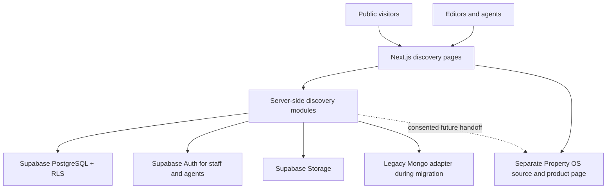

# Discovery target architecture

## Current vs target
Current repository: Next.js 13.5.1 App Router, TypeScript, Tailwind, MongoDB/Mongoose, JWT cookies, API routes, S3/local storage, PayHere integration, npm and GitHub Actions. Existing features must continue functioning. Target: Next.js modular monolith on Vercel, Supabase PostgreSQL/Auth/Storage for public discovery and editorial operations; no additional API server. Do not claim the migration is complete. Property OS has its own Next.js, Go and PostgreSQL runtime.

## Data model (proposed)
locations: id, slug, name, parent_id, centroid, publication state.
listings: id, source_reference, location_id, owner_org_id, type, purpose, price_lkr, price_period, public_description, public approximate location, permission_state, status, last_verified_at.
listing_media: listing_id, storage_key, rights_source, sort_order.
organizations, memberships: agent/editor scopes, roles; never use user-submitted roles.
guides, guide_revisions, cms_sections: slug, structured content, sources, review state, published_at, editor_id.
price_observations: listing/source id, observed_at, asking/transaction classification, amount, unit, coverage and permission.
enquiries: listing_id, consent_at, consent_version, contact, status, assigned_org, retention deadline.
placements: listing/partner id, sponsorship flag, starts_at, ends_at, status.
events: allowlisted event types, anonymous session where permitted, no contact information.

Postgres constraints, indexes and RLS must prevent cross-organization access. Public SELECT only for explicitly published, permissioned and approved projections. No private exact addresses, ownership evidence, tenant records or financial data in public payloads. Privileged service keys stay server-only. Staff MFA, server-side validation, rate limiting and audit logs. Prefer controlled storage uploads, media ownership verification and signed private reads.

## Transition
1. Preserve Mongo and all existing routes; build public tools with no new database dependency.
2. Inventory data and auth permissions; create additive Supabase migrations, dev fixtures and explicit discovery repository interface. Build and test RLS including anonymous/other-organization denial.
3. Implement source adapter and read-only import of consented public fields with legacy ID mapping, validation, deduplication and count checks. Do not copy JWT password hashes, private tenants or finance records into discovery.
4. Validate staging parity and switch public discovery reads using a server-side flag with reversible rollback. Keep legacy writes authoritative until explicit ownership cutover; avoid uncoordinated dual writes.
5. Add authenticated agent/editor publishing and scoped enquiry handling. Keep property operations legacy until a separate migration plan is approved.

## SEO and GEO
Server-render public content; route-specific canonical, metadata, sitemaps only for real published URLs; prevent indexing private routes and arbitrary query combinations. Publish human-reviewed guides with cited sources, update dates, clearly scoped claims and semantic headings. Use structured data only when it reflects visible content. No auto-generated thin location pages. Preserve URLs and add redirects for future slug changes.

## Release
Vercel preview + isolated Supabase staging; local Supabase CLI when adopted. Keep current npm lock and existing CI; upgrade framework separately after dependency/security audit. Require lint, typecheck, build, browser smoke, anonymous access and RLS checks before launch. Do not deploy or migrate live data in the foundation PR.
